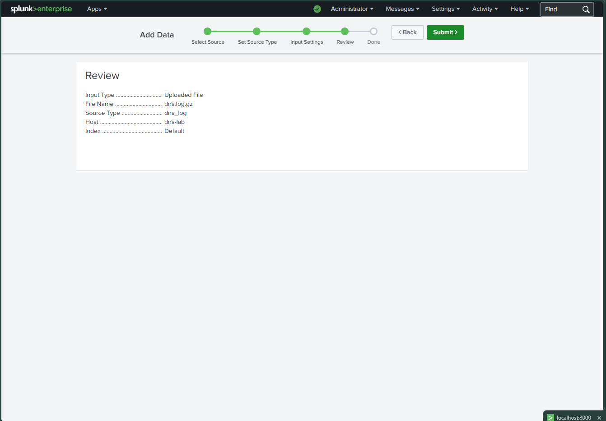
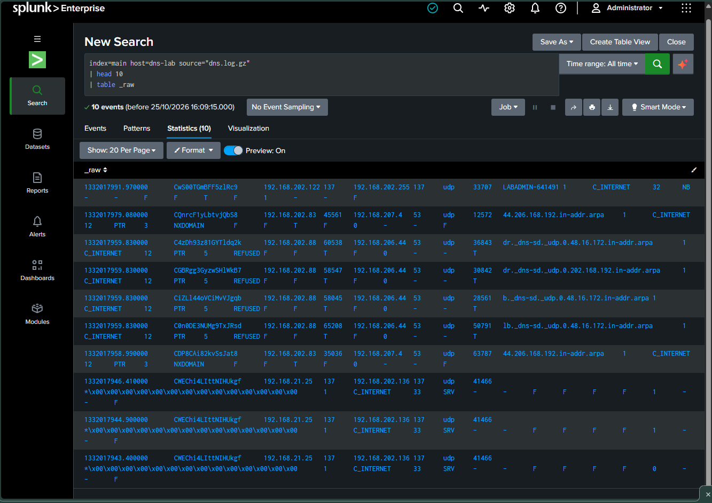
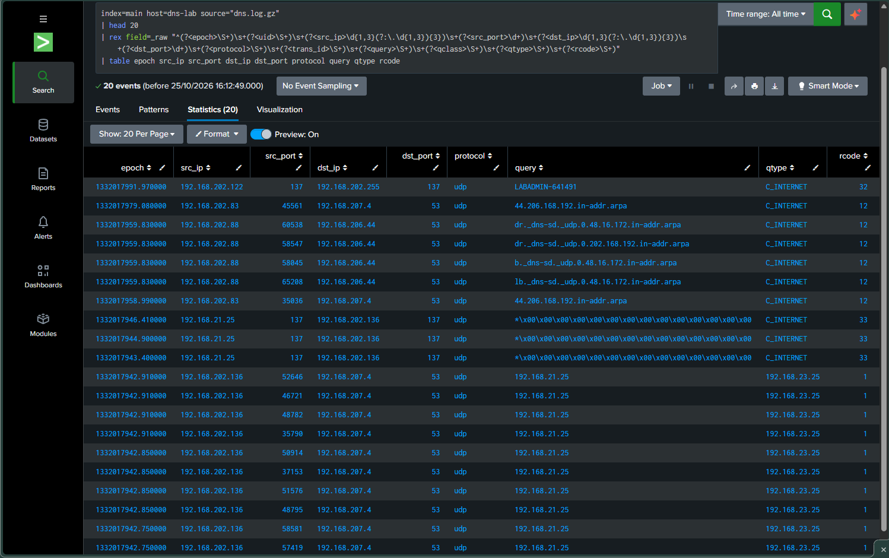
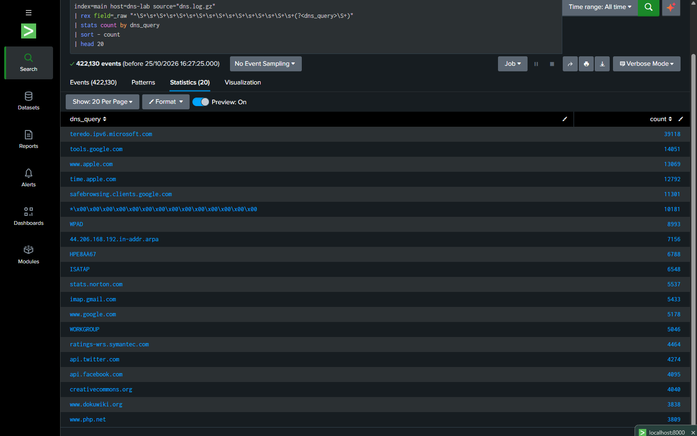
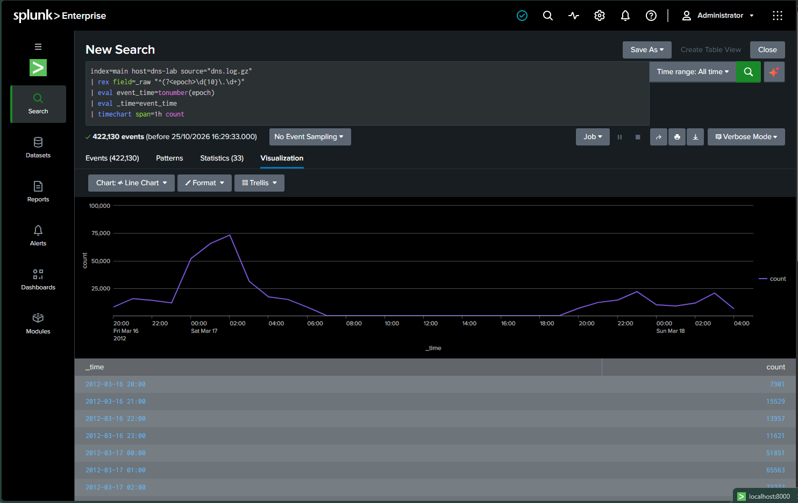
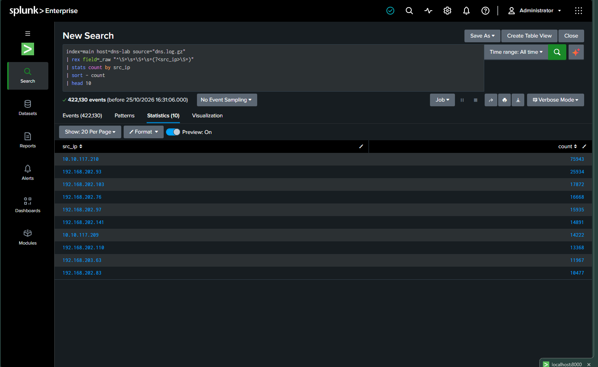
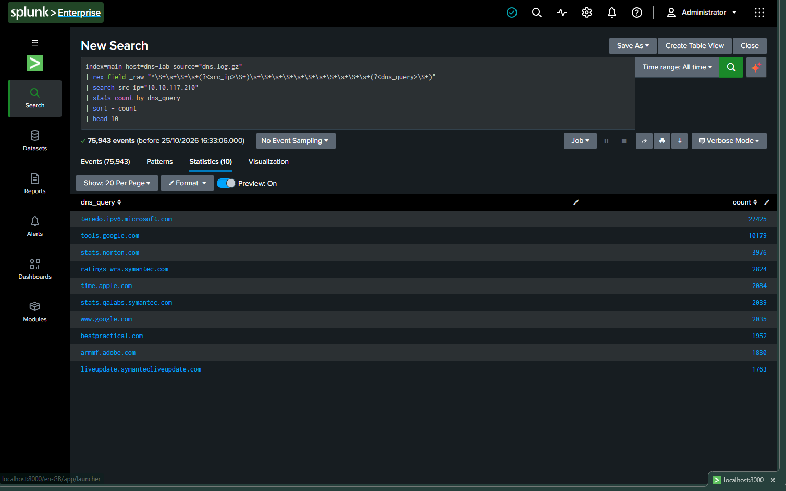
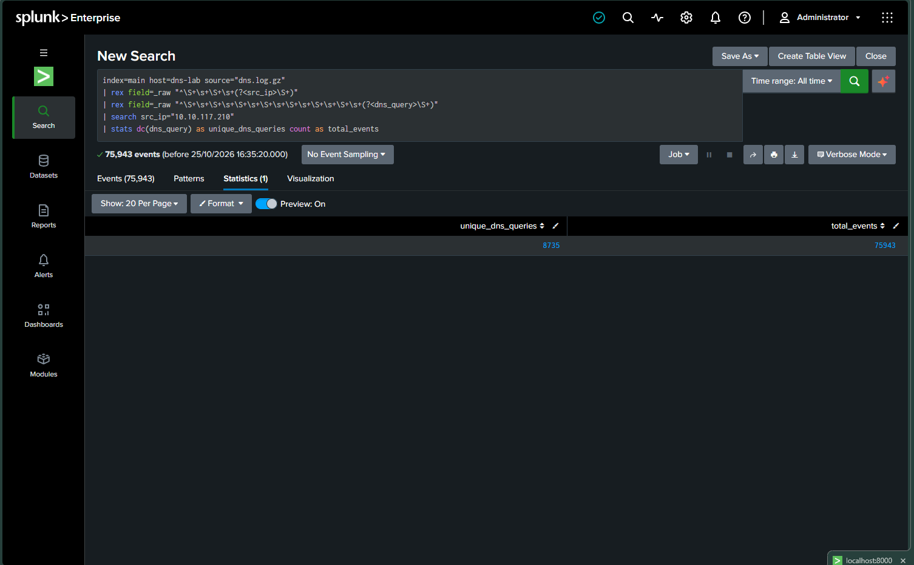

# DNS Log Analysis with Splunk

## Overview
This beginner cybersecurity project uses Splunk Enterprise to ingest and analyse DNS logs. The objective is to practise log analysis, identify frequently queried DNS names, review source IP activity, and visualise DNS event trends.

## Tools
- Splunk Enterprise
- SPL (Search Processing Language)
- GitHub for project documentation

## Dataset
- File: `dns.log.gz`
- Source: [SecRepo — MACCDC 2012 datasets](https://www.secrepo.com/)
- Dataset period: March 2012
- Indexed events: 422,130

## Investigation Steps
1. Imported DNS log data into Splunk.
2. Verified that events were searchable.
3. Analysed the most frequent DNS query values.
4. Visualised DNS event volume over time using the original timestamp.
5. Identified the source IPs with the highest event counts.
6. Investigated the DNS query values associated with the most active source IP.

## Findings

### Frequently Queried DNS Values
The most frequent extracted values included:
- `teredo.ipv6.microsoft.com` — 39,118 events
- `tools.google.com` — 14,051 events
- `www.apple.com` — 13,069 events
- `time.apple.com` — 12,792 events

### Most Active Source IP
- Source IP: `10.10.117.210`
- Events: 75,943
- Unique extracted query values: 8,735

These counts describe activity in the dataset and do not, by themselves, establish malicious behaviour.

## Limitations
- Some fields were extracted using regular expressions and require further validation against the original log format.
- Unique query values may include malformed or non-domain values.
- High query volume alone is not sufficient evidence of DNS tunnelling, malware, or other malicious activity.
- Further investigation should correlate source IPs, query types, response codes, and event timestamps.

## Repository Structure
- `queries/dns-analysis.spl` — SPL queries used during the investigation.
- `screenshots/` — Evidence captured from Splunk.

## Skills Practised
- Log ingestion and validation
- SPL searching and aggregation
- DNS query analysis
- Source IP activity analysis
- Time-series visualisation
- Evidence-based reporting

## Screenshots

### 1. Data Ingestion

### 2. Raw DNS Events

### 3. DNS Field Extraction

### 4. Top DNS Query Values

### 5. DNS Traffic Timeline

### 6. Top DNS Source IPs

### 7. DNS Queries by Source IP

### 8. Source IP Summary

## Disclaimer
This project uses a public historical dataset for educational purposes. Findings should not be interpreted as proof of a live security incident.
