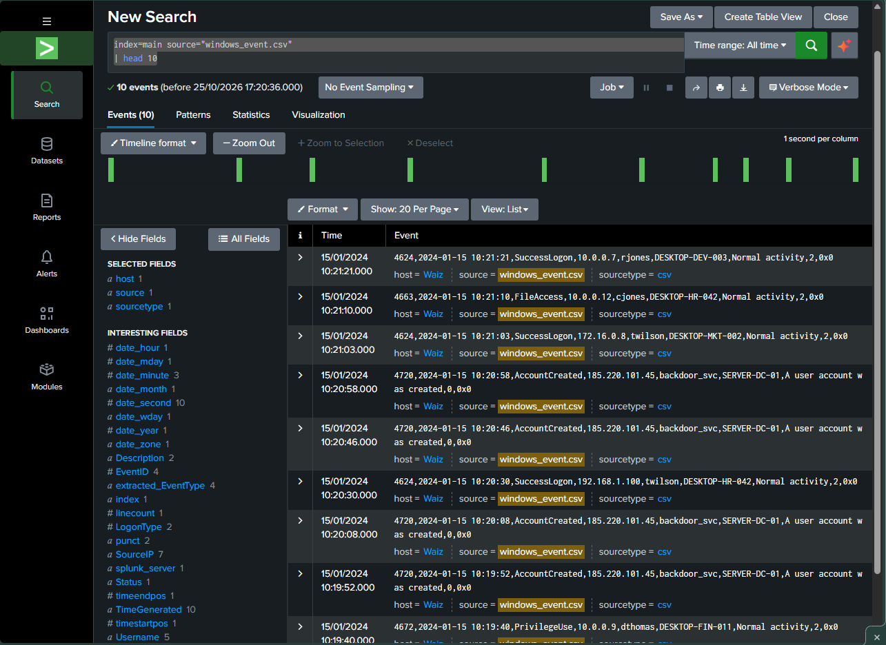
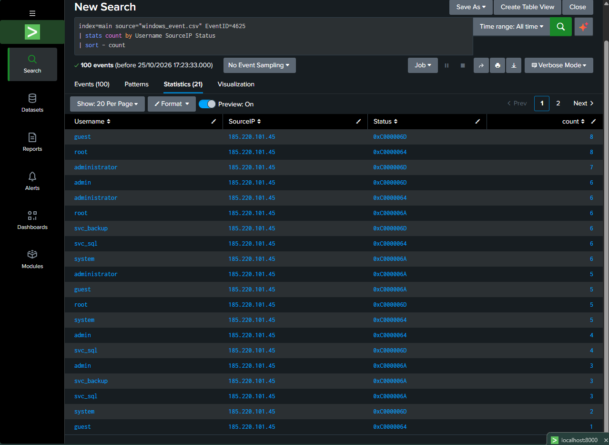
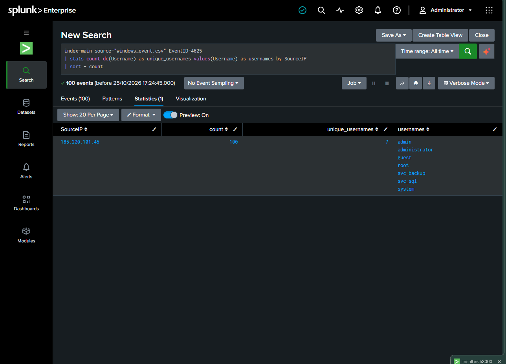
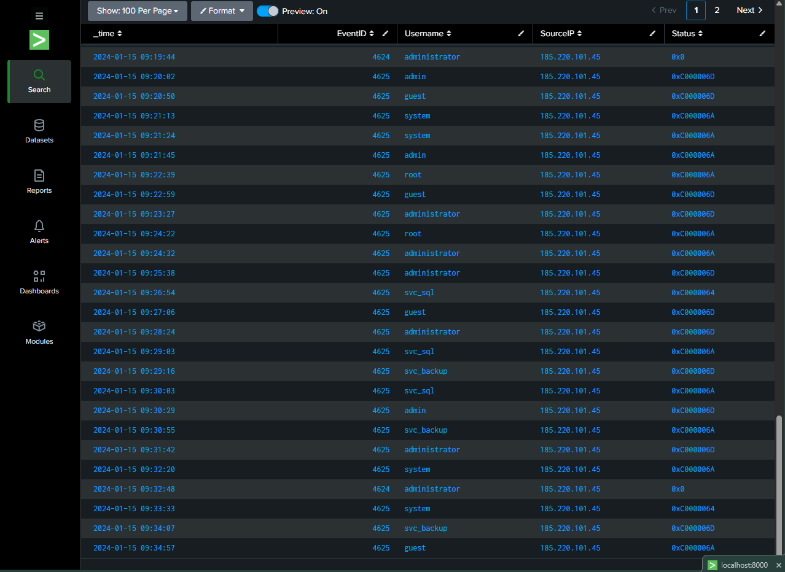
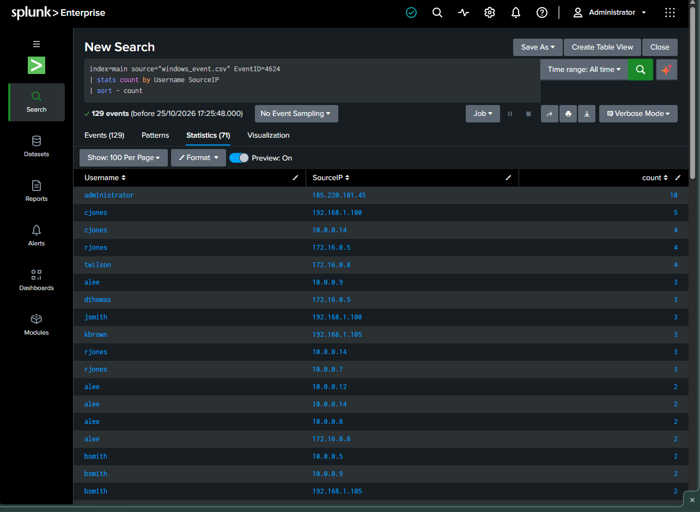

# Windows Security Log Analysis with Splunk

## 1. Overview

This project demonstrates a basic security investigation workflow using Splunk Enterprise to analyse Windows authentication events.

The investigation focuses on failed logon attempts, source IP activity, usernames involved in authentication failures, and the relationship between failed and successful logon events.

The objective is to identify suspicious authentication patterns and document findings using evidence from the dataset.

## 2. Tools and Technologies

- Splunk Enterprise
- Search Processing Language (SPL)
- Windows Event Log sample dataset
- GitHub

## 3. Dataset

- **File:** `windows_event.csv`
- **Source:** [SOC Sample Logs](https://github.com/SreejithReji/soc-sample-logs)
- **Format:** CSV
- **Purpose:** Educational security log analysis

The dataset contains simulated security events. The findings in this project apply only to the supplied sample data.

## 4. Investigation Methodology

The investigation followed these steps:

1. Imported `windows_event.csv` into Splunk.
2. Searched for failed logon events using Windows Event ID `4625`.
3. Grouped failed logon events by username, source IP address, and status.
4. Identified source IP addresses associated with multiple usernames.
5. Reviewed successful logon events using Event ID `4624`.
6. Examined the timeline of failed and successful logon events associated with a selected source IP.
7. Documented the findings and limitations of the investigation.

## 5. Key Findings

### 5.1 Failed Logon Activity

The Splunk search returned 100 failed logon events (Event ID `4625`) associated with source IP `185.220.101.45` in the analysed results.

The events involved seven distinct usernames:

- `admin`
- `administrator`
- `guest`
- `root`
- `svc_backup`
- `svc_sql`
- `system`

This pattern may indicate password guessing or account enumeration and warrants further investigation.

### 5.2 Successful Logon Activity

Successful logon events (Event ID `4624`) were also observed for the same source IP. The analysis identified 10 successful logon events associated with the `administrator` account in the results reviewed.

The presence of both failed and successful logon events from the same source IP makes this activity a priority for further investigation within the sample dataset.

However, the available findings do not independently establish that an account was compromised or that the successful logons resulted from the failed attempts.

### 5.3 Authentication Timeline

The timeline review showed both Event ID `4624` and Event ID `4625` associated with `185.220.101.45`.

Reviewing event timestamps helps an analyst investigate the sequence of authentication activity and determine whether additional evidence is required.

## 6. SPL Queries

### 6.1 Failed Logons by Username and Source IP

```spl
index=main source="windows_event.csv" EventID=4625
| stats count by Username SourceIP Status
| sort - count
```

**Purpose:** Summarises failed logon events by username, source IP address, and status.

### 6.2 Failed Logons by Source IP

```spl
index=main source="windows_event.csv" EventID=4625
| stats count dc(Username) as unique_usernames values(Username) as usernames by SourceIP
| sort - count
```

**Purpose:** Identifies source IP addresses associated with high volumes of failed logons and multiple usernames.

### 6.3 Successful and Failed Logon Timeline

```spl
index=main source="windows_event.csv" (EventID=4624 OR EventID=4625) SourceIP="185.220.101.45"
| table _time EventID Username SourceIP Status
| sort _time
```

**Purpose:** Reviews the timestamps and usernames associated with successful and failed logon events from the selected source IP.

## 7. Screenshots

### Data Ingestion



### Failed Logon Analysis



### Failed Logons by Source IP



### Authentication Investigation Timeline



### Successful Logon Analysis



## 8. Investigation Assessment

The combination of repeated failed logons, multiple usernames, and successful logon events associated with the same source IP provides a reasonable basis for further investigation.

In a real SOC environment, the next steps would include:

- Validating the event details against the original records.
- Reviewing the exact sequence of failed and successful logons.
- Checking the affected account and its expected login behaviour.
- Correlating the activity with other endpoint, network, and authentication logs.
- Documenting the evidence before deciding whether the activity is malicious.

## 9. Limitations

- The dataset is simulated and does not represent a confirmed real-world incident.
- Event counts alone cannot establish malicious intent.
- The relationship between failed and successful logons requires further validation.
- Findings depend on the accuracy of the fields extracted and the searches performed.
- No account compromise is claimed based on the available evidence alone.

## 10. Skills Practised

- Windows authentication log analysis
- Splunk SPL search and aggregation
- Windows Event ID investigation (`4624` and `4625`)
- Source IP and username correlation
- Authentication timeline analysis
- Security investigation documentation

## Disclaimer

This project is intended for educational and portfolio purposes. The findings describe activity in a simulated dataset and should not be interpreted as confirmation of a real security incident.
