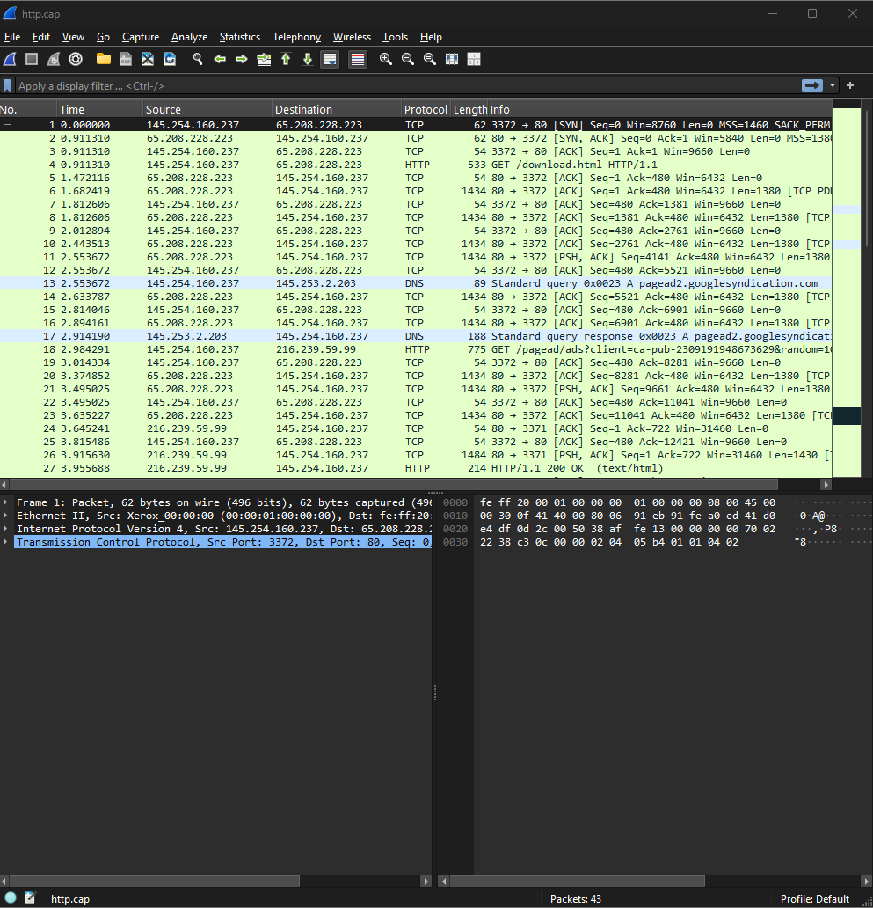
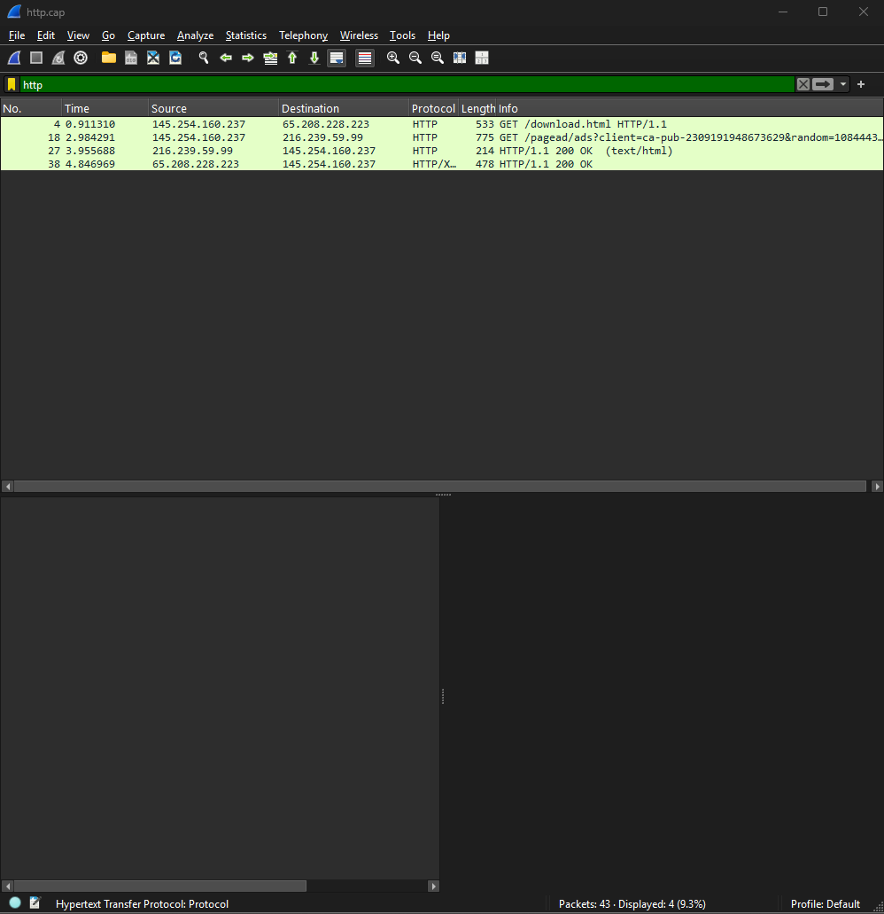
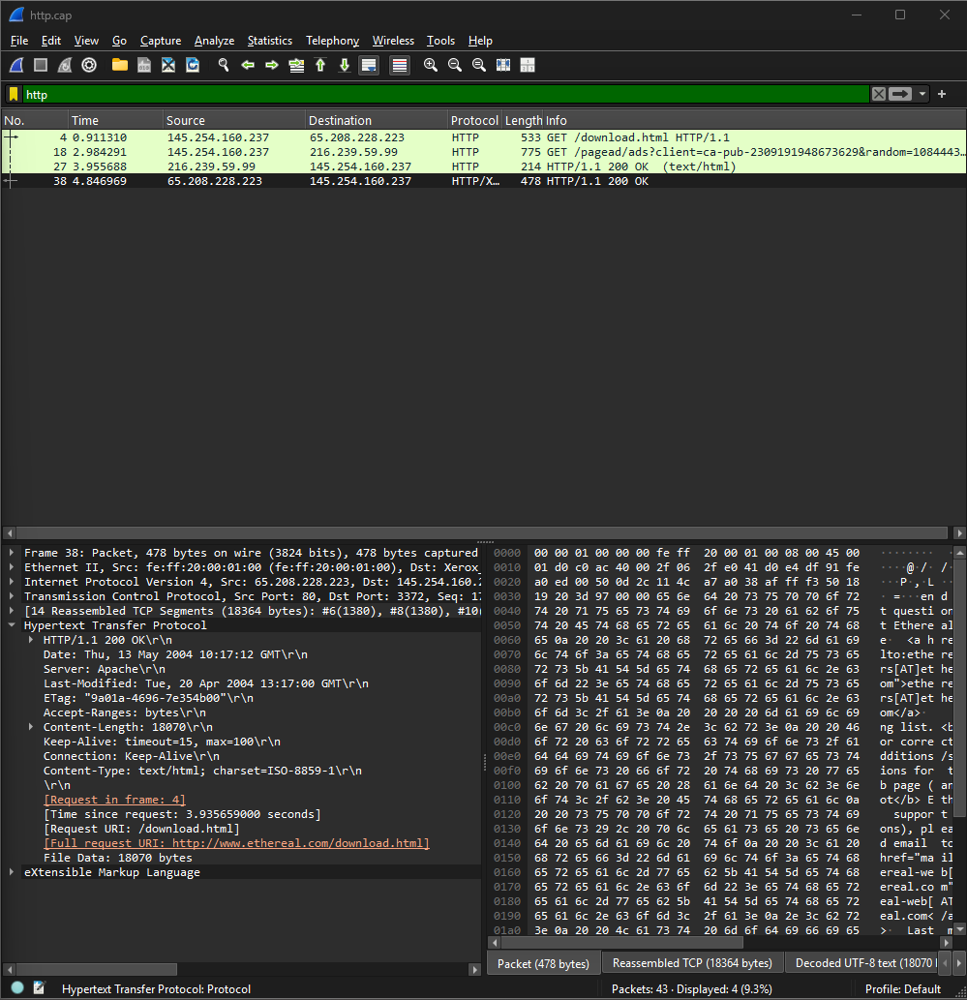
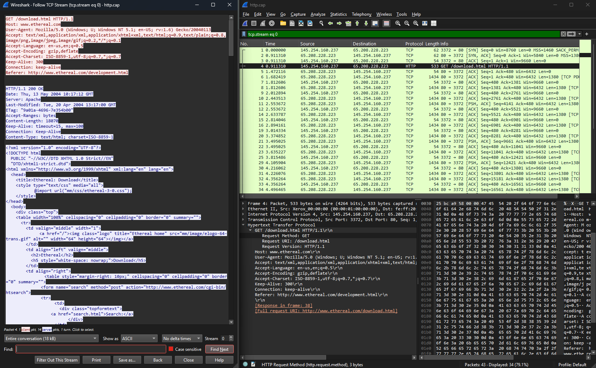
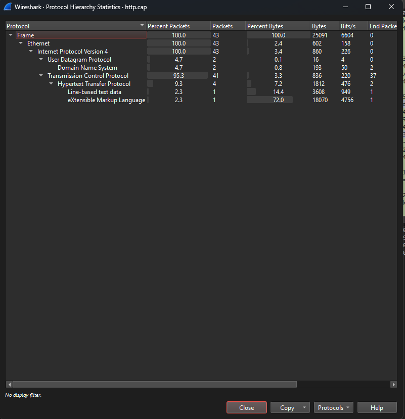
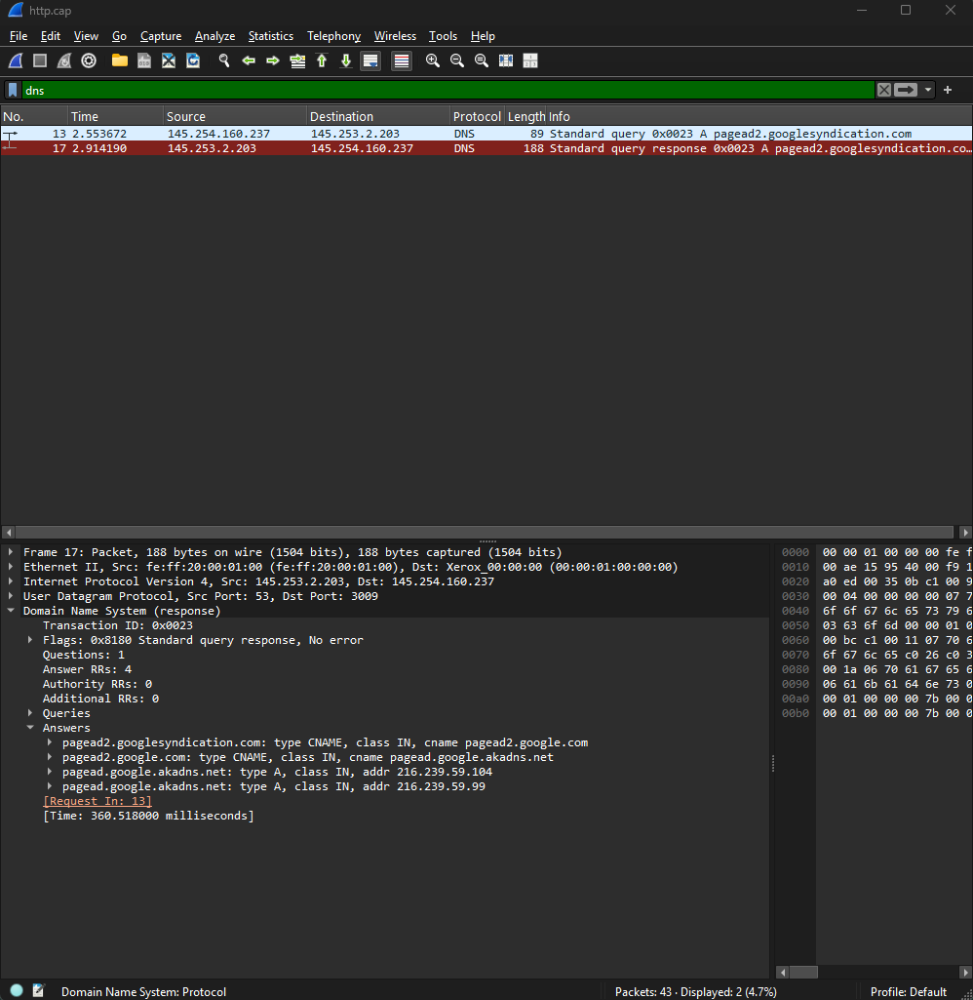

# Network Traffic Analysis with Wireshark

## Project Overview
This project demonstrates basic network traffic analysis using Wireshark. A sample PCAP file (`http.cap`) was examined to understand HTTP communication, DNS resolution, TCP traffic, and protocol distribution.

## Objectives
- Inspect network packets using Wireshark.
- Analyze HTTP requests and server responses.
- Examine TCP streams and readable HTTP content.
- Investigate DNS queries and responses.
- Review protocol distribution and document security observations.

## Tools and Dataset
- **Tool:** Wireshark
- **Dataset:** `http.cap` — sample packet capture
- **Analysis type:** Offline PCAP analysis

## Investigation and Findings

### 1. Packet Overview
The capture contained **43 packets**. A display filter was used to isolate HTTP traffic and inspect individual packets.

### 2. HTTP Request Analysis
The request `GET /download.html HTTP/1.1` was observed.

- **Client IP:** `145.254.160.237`
- **Server IP:** `65.208.228.223`
- **Destination port:** `80`
- **Host:** `www.ethereal.com`
- **Referer:** `http://www.ethereal.com/development.html`

The request headers included a User-Agent identifying a Mozilla-based client on Windows.

### 3. HTTP Response Analysis
The corresponding server response contained the following headers:

- **Status:** `HTTP/1.1 200 OK`
- **Server:** Apache
- **Content-Type:** `text/html; charset=ISO-8859-1`
- **Content-Length:** `18070` bytes

The successful HTTP response indicates that the server returned content for the request. It does not independently establish that the content was safe.

### 4. TCP Stream Inspection
Wireshark's **Follow TCP Stream** feature was used to inspect the HTTP request, response headers, and returned HTML content.

This demonstrated that the contents of this HTTP exchange were readable in the capture because the communication was not encrypted with HTTPS.

### 5. DNS Analysis
The capture contained a DNS query for `pagead2.googlesyndication.com`.

The response included a CNAME chain:
- `pagead2.googlesyndication.com`
- `pagead2.google.com`
- `pagead.google.akadns.net`

The response returned IPv4 addresses `216.239.59.104` and `216.239.59.99`. Wireshark reported a response time of approximately **360.518 ms**.

The domain name suggests advertising-related traffic, but the domain and DNS response alone do not indicate malicious activity.

### 6. Protocol Hierarchy
The Protocol Hierarchy view reported:

| Protocol | Packets | Percentage |
|---|---:|---:|
| IPv4 | 43 | 100% |
| TCP | 41 | 95.3% |
| UDP | 2 | 4.7% |
| DNS | 2 | 4.7% |
| HTTP | 4 | 9.3% |

Protocol counts overlap across protocol layers and should not be added together as though they were mutually exclusive.

## Screenshots

### Packet Capture Overview

### HTTP Traffic Analysis

### HTTP Response Analysis

### TCP Stream Inspection

### Protocol Hierarchy

### DNS Analysis

## Security Observations
- HTTP traffic can expose request headers and response content to anyone able to capture the traffic.
- DNS records can reveal the domains that a client is attempting to access.
- A successful HTTP response or an advertising-related domain is not, by itself, evidence of compromise.
- Network findings should be correlated with additional telemetry before determining whether activity is malicious.

## Limitations
- This exercise uses a sample PCAP file and is not a live enterprise investigation.
- The capture provides limited context about the client, server, and surrounding activity.
- No conclusion about malware, compromise, or attacker intent can be made from these observations alone.

## Skills Demonstrated
- Wireshark packet inspection
- HTTP request and response analysis
- TCP stream reconstruction
- DNS query and response analysis
- Protocol hierarchy analysis
- Evidence-based security reporting

## Conclusion
This project demonstrates a basic workflow for examining packet captures, identifying network protocols, inspecting HTTP and DNS activity, and documenting observations without overstating the available evidence.
