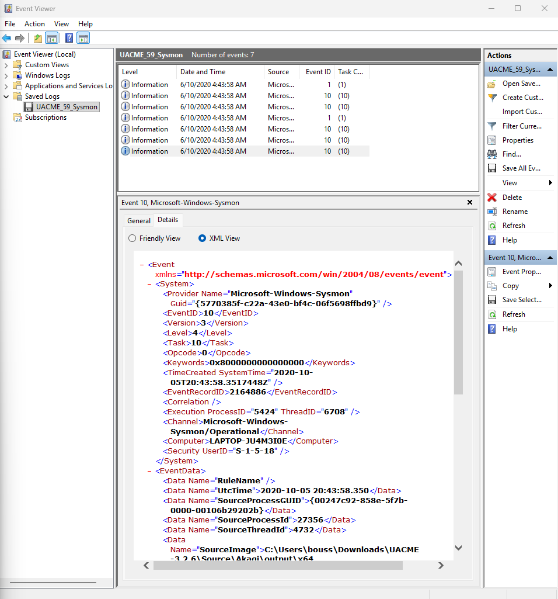
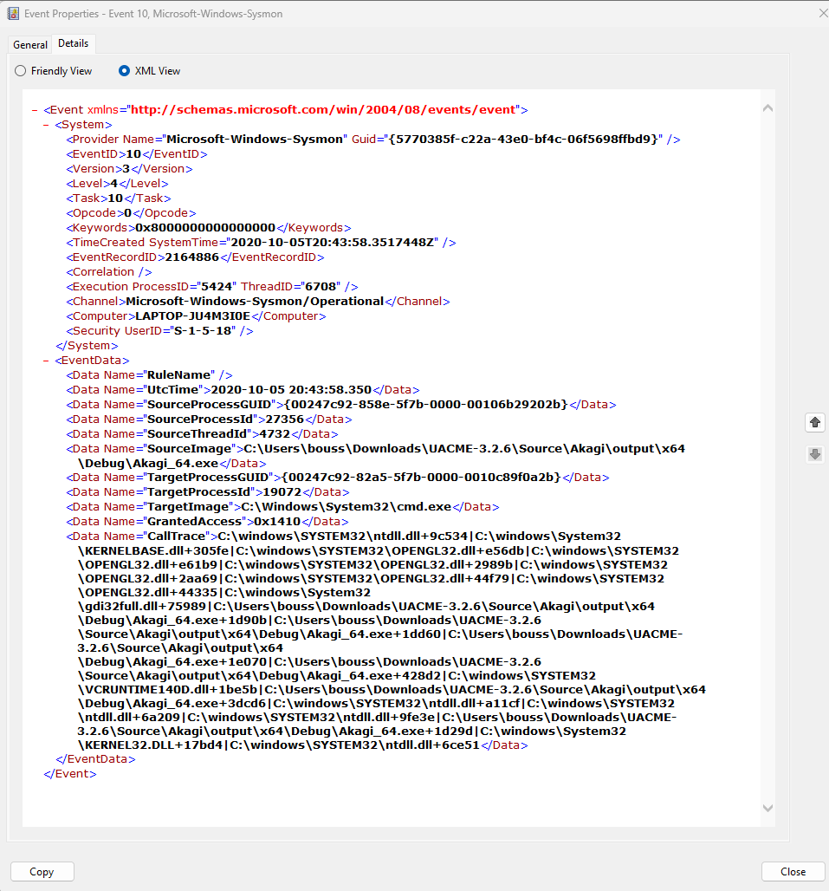
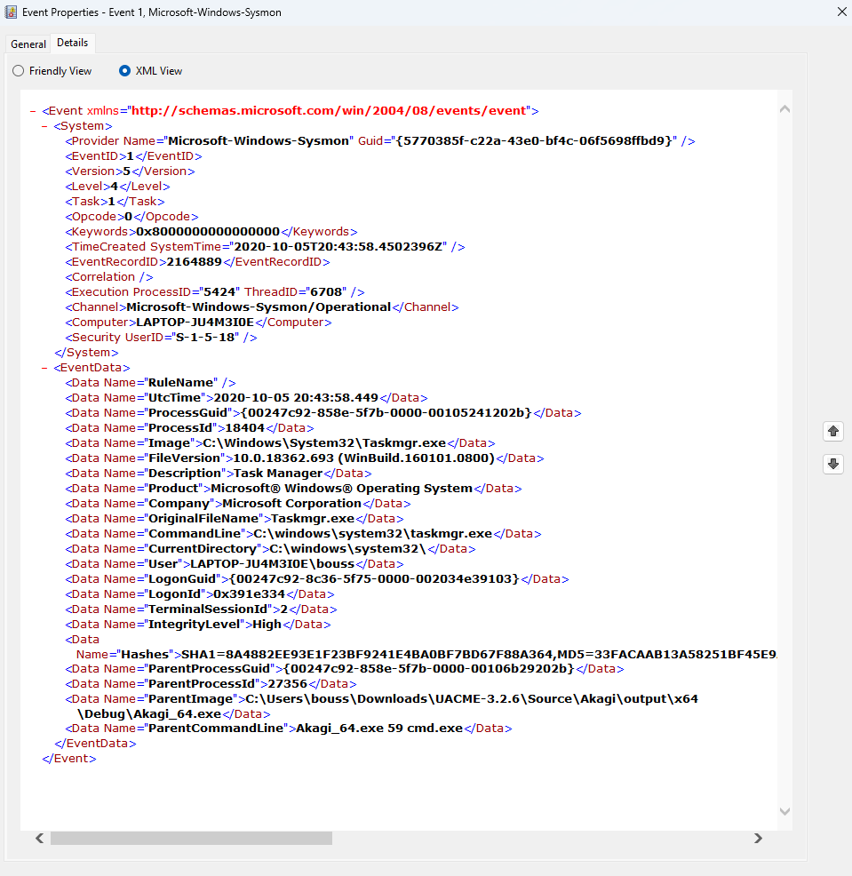

# Windows Privilege Escalation Investigation with Sysmon

## Project Overview
This project investigates Windows Sysmon event logs to examine process creation and process access activity associated with a potential User Account Control (UAC) bypass scenario.

The investigation uses the `UACME_59_Sysmon.evtx` sample log and focuses on correlating Event ID 1 (Process Create) and Event ID 10 (Process Access).

## Objectives
- Analyze Windows Sysmon events.
- Investigate process creation and parent-child relationships.
- Examine process access involving `Akagi_64.exe`, `Taskmgr.exe`, and `cmd.exe`.
- Build a timeline from event timestamps.
- Document findings and limitations using evidence-based analysis.

## Tools and Dataset
- **Tool:** Windows Event Viewer
- **Log source:** `UACME_59_Sysmon.evtx`
- **Log provider:** Microsoft-Windows-Sysmon
- **Event IDs:** 1 (Process Create), 10 (Process Access)

## Investigation Findings

### 1. Event Overview
The saved event log contains seven events, including two Event ID 1 records and five Event ID 10 records.

### 2. Process Access — Event ID 10
One event recorded the following process access:

- **Source process:** `Akagi_64.exe`
- **Target process:** `C:\Windows\System32\cmd.exe`
- **Source PID:** `27356`
- **Target PID:** `19072`
- **GrantedAccess:** `0x1410`
- **Timestamp (UTC):** `2020-10-05 20:43:58.350`

The source executable path is located within the UACME project directory. This context makes the event relevant to further investigation, but process access alone does not prove successful privilege escalation or process injection.

### 3. Process Creation — Event ID 1
Another event recorded:

- **Process:** `C:\Windows\System32\Taskmgr.exe`
- **Process ID:** `18404`
- **Parent process:** `Akagi_64.exe`
- **Parent command line:** `Akagi_64.exe 59 cmd.exe`
- **Integrity level:** `High`
- **Timestamp (UTC):** `2020-10-05 20:43:58.449`

This establishes that `Akagi_64.exe` was recorded as the parent of `Taskmgr.exe` in this event. It does not, by itself, establish whether a UAC bypass succeeded.

### 4. Timeline
All timestamps below are in UTC on 5 October 2020.

| Time (UTC) | Event ID | Source | Target / Child | Observation |
|---|---:|---|---|---|
| 20:43:58.350 | 10 | `Akagi_64.exe` (PID 27356) | `cmd.exe` (PID 19072) | Process access recorded. |
| 20:43:58.389 | 10 | `svchost.exe` (PID 11640) | `explorer.exe` (PID 27356) | Process access recorded. |
| 20:43:58.393 | 10 | `svchost.exe` (PID 11640) | `explorer.exe` (PID 27356) | Similar access recorded milliseconds later. |
| 20:43:58.449 | 10 | `svchost.exe` (PID 11640) | `Taskmgr.exe` (PID 18404) | Process access recorded. |
| 20:43:58.450 | 10 | `explorer.exe` (PID 27356) | `Taskmgr.exe` (PID 18404) | Process access recorded. |
| 20:43:58.449 | 1 | `Akagi_64.exe` | `Taskmgr.exe` (PID 18404) | Process creation recorded with `Akagi_64.exe` as parent. |

Note: Event Viewer displays timestamps rounded to the nearest second in the list. The timeline uses the more precise UTC timestamps from the event XML. Event ordering at sub-millisecond resolution should be interpreted cautiously.

## Screenshots

### Event Overview

### Akagi Process Access

### Process Creation

## Security Assessment
The presence of `Akagi_64.exe` in process access and process creation events warrants further investigation because it is located in a UACME project directory and is associated with a command-line argument referencing `cmd.exe`.

However, the available events do not conclusively prove successful UAC bypass, privilege escalation, or process injection. Additional event correlation and contextual evidence would be required.

## Limitations
- This analysis is based on a small sample of seven Sysmon events.
- The log does not provide enough evidence to confirm the full execution chain or the success of a UAC bypass.
- The `cmd.exe` PIDs in the available events differ (`19072` and `6636`); they should not be treated as the same process without additional evidence.
- The investigation is a review of a saved log, not a live incident response exercise.

## Skills Demonstrated
- Windows Event Viewer
- Sysmon Event ID 1 and Event ID 10 analysis
- Parent-child process investigation
- Process access investigation
- Timeline construction
- Evidence-based security reporting

## Conclusion
This project demonstrates how Sysmon logs can be used to investigate process activity and identify events that warrant further review. Findings are documented with clear distinctions between observed evidence and conclusions that cannot yet be confirmed.
