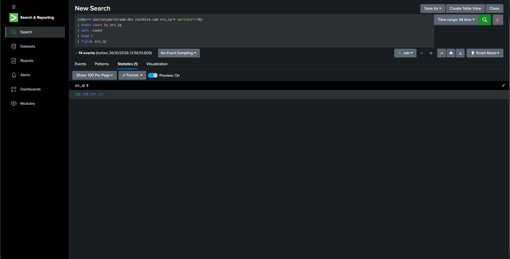
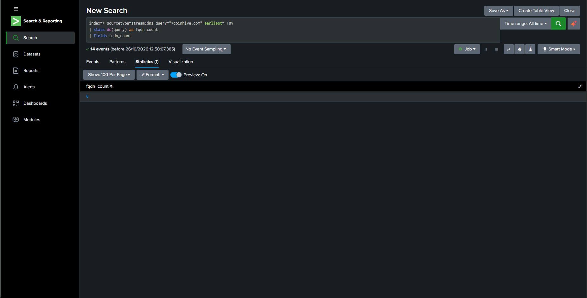
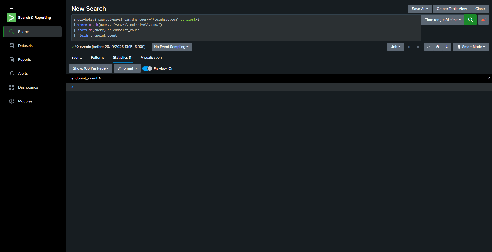
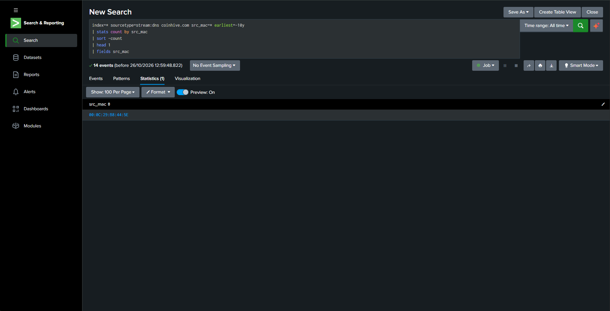

# 05 — Coinhive Cryptojacking Threat Hunt

## Overview

This project investigates DNS indicators associated with suspected browser-based cryptocurrency mining using Splunk Enterprise and the Boss of the SOC (BOTS) v3 dataset.

The investigation follows Scenario 03 from the public `splunk-bots-hunts` repository.

**Tools:** Splunk Enterprise, SPL  
**Dataset:** Splunk BOTS v3  
**Focus:** DNS threat hunting and endpoint identification

## Investigation Objectives

- Identify the internal source IP generating Coinhive-related DNS lookups.
- Count distinct Coinhive-related fully qualified domain names (FQDNs).
- Count distinct `ws*.coinhive.com` endpoint names.
- Identify the source MAC address associated with the DNS events.

## Findings

| Hunt | Result |
|---|---|
| Internal source IP | `192.168.247.131` |
| Unique Coinhive FQDNs | 6 |
| Unique mining endpoint names | 5 |
| Source MAC address | `00:0C:29:B8:44:5E` |
| Host identified by the reference scenario | `BSTOLL-L` |

These results match the expected answers published by the reference scenario. The queries below are scoped to `index=botsv3`, which is the index used in this local lab.

## Hunting Queries

### 1. Identify the Internal Host

```spl
index=botsv3 sourcetype=stream:dns query="*coinhive.com" earliest=0
| stats count by src_ip
| sort -count
| head 1
| fields src_ip
```

**Expected result:** `192.168.247.131`

### 2. Count Unique Coinhive Domains

```spl
index=botsv3 sourcetype=stream:dns query="*coinhive.com" earliest=0
| stats dc(query) as fqdn_count
| fields fqdn_count
```

**Expected result:** `6`

### 3. Count Mining Endpoint Names

```spl
index=botsv3 sourcetype=stream:dns query="*coinhive.com" earliest=0
| where match(query, "^ws.*\\.coinhive\\.com$")
| stats dc(query) as endpoint_count
| fields endpoint_count
```

**Expected result:** `5`

The regular expression filters for names beginning with `ws` and ending in `.coinhive.com`, avoiding the mid-string wildcard warning from the original search.

### 4. Identify the Source MAC Address

```spl
index=botsv3 sourcetype=stream:dns query="*coinhive.com" src_mac=* earliest=0
| stats count by src_mac
| sort -count
| head 1
| fields src_mac
```

**Expected result:** `00:0C:29:B8:44:5E`

## Analysis and Limitations

The DNS events show repeated lookups for Coinhive-related names, including five distinct names matching the `ws*.coinhive.com` pattern. The source IP and MAC address match the host identified as `BSTOLL-L` in the reference scenario.

This is evidence of Coinhive-related DNS activity and supports further investigation for possible cryptojacking. **DNS lookups alone do not prove that mining code executed, that CPU resources were used for mining, or that the site delivered the script.** Those claims require corroboration from HTTP, endpoint, or other relevant telemetry.

## MITRE ATT&CK

The reference scenario maps the broader investigation to:

- **T1496 — Resource Hijacking**
- **T1059.007 — JavaScript**
- **T1071.001 — Web Protocols**
- **T1189 — Drive-by Compromise**

These are reference-scenario mappings, not techniques independently proven by the four DNS queries documented here.

## Evidence

### 1. Internal Host


### 2. Unique Coinhive FQDNs


### 3. Mining Endpoint Names


### 4. Source MAC Address


> Note: rerun Query 3 and replace its screenshot so the evidence shows the corrected SPL query.

## Reference

[Splunk BOTS Hunts — Scenario 03: BSTOLL-L Browser Cryptojacking](https://github.com/JacobRHess/splunk-bots-hunts/tree/main/scenarios/03-bstoll-coinhive-cryptojacking)

This project uses a public training dataset for cybersecurity learning and portfolio demonstration. It does not represent a real production incident.
